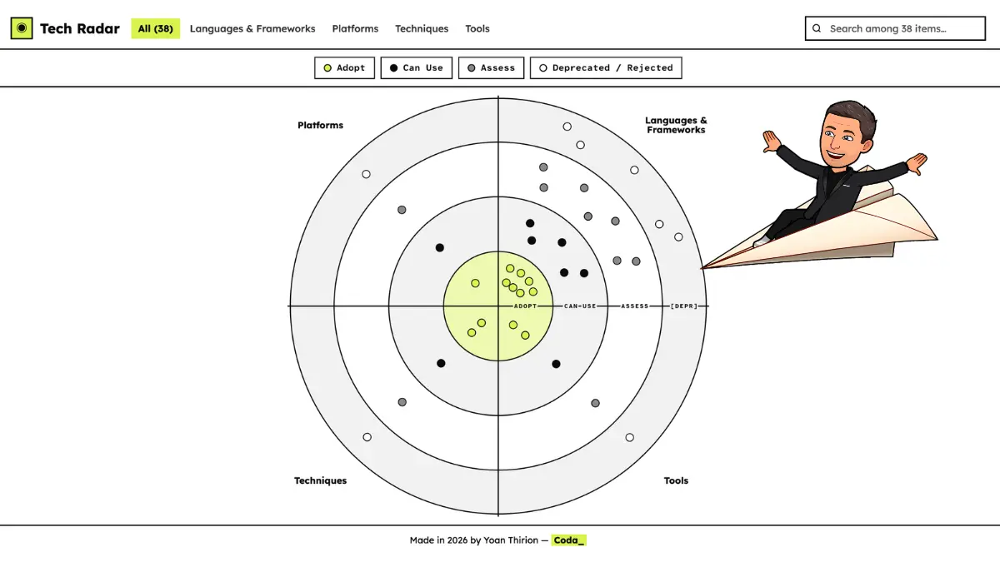

# Tech Radar
[](https://github.com/Coda-Dijon/tech-radar/actions/workflows/build.yml)
[](https://github.com/Coda-Dijon/tech-radar/actions/workflows/green-it-analysis.yml)
[](https://claude.ai/code)
[](LICENSE)

<a href="https://bff.ecoindex.fr/redirect/?url=https://coda-dijon.github.io/tech-radar/" target="_blank">
    
</a>

Générateur de site statique pour un radar technologique basé sur Markdown.



## Ajouter un item en 1 minute

1. Créer un fichier dans `content/<quadrant>/nom-technologie.md`
2. Remplir le `frontmatter` YAML
3. Écrire le contenu Markdown
4. Push

```
content/
├── languages-frameworks/   # TypeScript, Go, Rust…
├── platforms/              # Kubernetes, AWS, Cloudflare…
├── techniques/             # TDD, Event Sourcing, IaC…
└── tools/                  # GitHub Actions, Vite, Bun…
```

## Format d'un item

```yaml
---
title: Nom de la technologie
ring: adopt          # adopt | can-use | assess | hold
quadrant: tools      # languages-frameworks | platforms | techniques | tools
tags: [tag1, tag2]
date: 2024-01-15     # YYYY-MM-DD
description: Courte description (1 ligne, ~100 caractères)
---

## Contenu en Markdown

Corps libre de l'article...
```

### Définition des rings

| Ring                      | Signification                                                                                              |
|---------------------------|------------------------------------------------------------------------------------------------------------|
| **adopt**                 | We have capacity to use these solutions, already deployed in production. First choices for new projects.   |
| **can use**               | Pertinence demonstrated. You can use it on your project but must justify not using the default choice.     |
| **assess**                | May bring value. Needs to be assessed and tested in our environment to confirm or reject this vision.      |
| **deprecated / rejected** | For various reasons these solutions are no longer recommended — use only for maintenance of existing code. |

## Développement

```bash
npm install
npm run build   # génère le site dans dist/
npm run dev     # build + serveur local sur http://localhost:3000
```

## Validation

```bash
npm run validate   # vérifie tous les frontmatters, fail si erreur
```